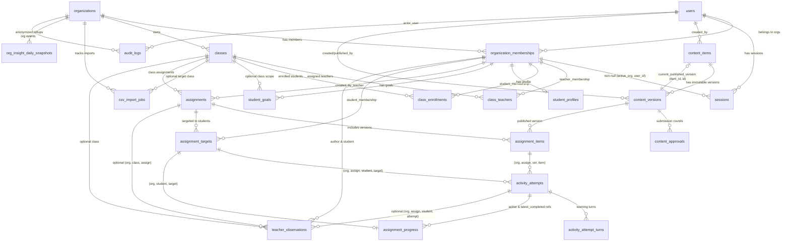

# MIMORA — Database Schema Design & Data Integrity Specification

**Task:** P1-02R-FIX1 (Revision of P1-02 / P1-02R)  
**Target Database:** TiDB Cloud Serverless (`8.0.11-TiDB-v8.5.3-serverless`, MySQL-compatible)  
**Target ORM:** Drizzle ORM (`drizzle-orm/mysql-core`) + `mysql2`  
**Status:** `[DESIGN SPECIFICATION ONLY — REVISED IN P1-02R-FIX1 — NOT YET MIGRATED TO TiDB]`

---

### Quy ước nhãn trạng thái quyết định

Mọi quyết định thiết kế trong tài liệu được gắn nhãn rõ ràng theo 4 trạng thái:
- **`[APPROVED]`**: Đã được Product Owner / Technical Lead phê duyệt.
- **`[ASSUMPTION]`**: Giả định kỹ thuật hoặc ngưỡng đề xuất phục vụ đặc tả; có thể điều chỉnh nếu chưa chốt chính thức.
- **`[DEFERRED]`**: Quyết định sản phẩm/pháp lý chưa chốt, giữ nguyên mở để PO/Legal quyết định sau.
- **`[UNVERIFIED]`**: Hành vi phụ thuộc cấu hình thực tế trên cụm TiDB Serverless hoặc Drizzle tooling, chưa chạy thực thi trong P1-02R.

---

## 1. Schema Overview

Schema MVP của MIMORA gồm **22 bảng** chia thành 7 nhóm chức năng cho kiến trúc Modular Monolith (React + Vite + Express). P1-02R giữ nguyên cấu trúc 22 bảng và tăng cường toàn vẹn tham chiếu liên bảng, chống race-condition cho learning attempts, lưu vết đầy đủ lịch sử duyệt nội dung, và bổ sung chính sách chống suy diễn cá nhân cho aggregate insights.

### Phân loại phạm vi sở hữu dữ liệu (22 bảng)

| Nhóm phạm vi | Số bảng | Danh sách bảng |
|---|---:|---|
| **Strictly Tenant-Owned (`organization_id NOT NULL`)** | **15** | `organization_memberships`, `classes`, `class_teachers`, `class_enrollments`, `student_profiles`, `student_goals`, `csv_import_jobs`, `assignments`, `assignment_items`, `assignment_targets`, `activity_attempts`, `activity_attempt_turns`, `assignment_progress`, `teacher_observations`, `org_insight_daily_snapshots` |
| **Mixed-Scope (`organization_id NULL`-able)** | **2** | `sessions` (`active_organization_id`), `audit_logs` (`organization_id`) |
| **Platform / Root / Shared Global (Không có `organization_id`)** | **5** | `organizations` (tenant root), `users` (global identity), `content_items`, `content_versions`, `content_approvals` |
| **Tổng cộng** | **22** | Khớp 7 nhóm dữ liệu (`A:4, B:6, C:3, D:6, E:1, F:1, G:1`) |

### Quy ước kiểu dữ liệu & Collation chuẩn hóa

- **Primary Keys & Foreign Key UUIDs (`[APPROVED]` + `[UNVERIFIED]` Drizzle DDL check):**
  - Toàn bộ khóa chính `id` và cột UUID tham chiếu dùng **`CHAR(36) CHARACTER SET ascii COLLATE ascii_bin`** (UUIDv7 do server tạo ở dạng chữ thường chuẩn RFC 9562: `xxxxxxxx-xxxx-7xxx-yxxx-xxxxxxxxxxxx`).
  - **Tính nhất quán bắt buộc cho FK:** Mọi cột `CHAR(36)` tham gia `PRIMARY KEY`, `UNIQUE KEY` hoặc `FOREIGN KEY` trên tất cả 22 bảng **bắt buộc dùng cùng một `CHARACTER SET ascii COLLATE ascii_bin`** để tránh lỗi không tương thích collation khi tạo composite FK trên TiDB và giảm kích thước lưu trữ từ `utf8mb4` (tối đa 4B/char) xuống `ascii` (1B/char).
- **Timestamps (`[APPROVED]`):** `DATETIME(3)` lưu hoàn toàn theo **UTC** (tránh `TIMESTAMP` để không gặp giới hạn năm 2038 và lệch múi giờ).
- **Login Identifiers & Normalization (`[APPROVED]`):**
  - `organizations.code`: Lưu và truy vấn dạng `trim().toUpperCase()`, `VARCHAR(64) CHARACTER SET ascii COLLATE ascii_bin` (hoặc `utf8mb4_0900_ai_ci` nếu cho phép ký tự mở rộng; khuyến nghị `[A-Z0-9_-]`).
  - `users.email`: Lưu và truy vấn dạng `trim().toLowerCase()`, `VARCHAR(255) CHARACTER SET utf8mb4 COLLATE utf8mb4_0900_ai_ci`.
  - `users.platform_username` và `organization_memberships.org_username`: Lưu và truy vấn dạng `trim().toLowerCase()`, regex `^[a-z0-9][a-z0-9._-]{1,63}$` — **tuyệt đối cấm ký tự `@`** để loại trừ hoàn toàn xung đột/nhập nhằng giữa `email` và `platform_username` khi đăng nhập. Sử dụng `CHARACTER SET ascii COLLATE ascii_bin` (vì đã chuẩn hóa chữ thường trước khi ghi).
- **Enums / Trạng thái (`[APPROVED]`):** Dùng `VARCHAR(...)` kết hợp `zod` + service-layer validation bắt buộc vì `tidb_enable_check_constraint` mặc định là **`OFF`** trong TiDB v8.5 (`KI-09`).
- **JSON (`[APPROVED]`):** Dùng kiểu `JSON` cho payload linh hoạt; mọi cột cần `WHERE`/`JOIN`/`ORDER BY` đều là cột SQL chuẩn.

---

## 2. Entity Relationship Diagram (Mermaid)



---

## 3. Data Dictionary chi tiết

*(Mọi cột UUID `CHAR(36)` dùng chung `CHARACTER SET ascii COLLATE ascii_bin`.)*

### Nhóm A — Identity & Organization

#### 3.1. `organizations`
- **Mục đích:** Lưu thông tin từng tổ chức/trường học (tenant boundary gốc).
- **Columns:**
  - `id` `CHAR(36)` `NOT NULL` — PK (UUIDv7)
  - `code` `VARCHAR(64)` `NOT NULL` — Mã trường chuẩn hóa uppercase (`THCS-LELOI`)
  - `name` `VARCHAR(255)` `NOT NULL`
  - `status` `VARCHAR(32)` `NOT NULL DEFAULT 'active'` — `active | suspended`
  - `created_at` `DATETIME(3)` `NOT NULL`
  - `updated_at` `DATETIME(3)` `NOT NULL`
- **PK:** `(id)`
- **FK:** Không có
- **Unique:** `uq_organizations_code (code)`
- **Explicit Index:** `idx_organizations_status (status)`
- **Quy tắc truy cập:** Chỉ `platform_admin` được tạo/cập nhật/liệt kê; user trong org chỉ xem thông tin tối thiểu của org đang hoạt động.

#### 3.2. `users`
- **Mục đích:** Danh tính xác thực lõi cấp hệ thống. Không chứa `teacher`/`student` role.
- **Columns:**
  - `id` `CHAR(36)` `NOT NULL` — PK (UUIDv7)
  - `email` `VARCHAR(255)` `NULL` — Chuẩn hóa lowercase; `NULL`-able vì Student không cần email
  - `platform_username` `VARCHAR(64)` `NULL` — Chuẩn hóa lowercase, **cấm ký tự `@`** (`^[a-z0-9][a-z0-9._-]{1,63}$`)
  - `platform_role` `VARCHAR(32)` `NULL` — Chỉ chấp nhận `'platform_admin'` hoặc `NULL` (**không có `org_admin`** `[APPROVED]`)
  - `display_name` `VARCHAR(255)` `NOT NULL`
  - `password_hash` `VARCHAR(255)` `NOT NULL` — Định dạng `scrypt$v1$...`
  - `password_updated_at` `DATETIME(3)` `NOT NULL`
  - `status` `VARCHAR(32)` `NOT NULL DEFAULT 'active'` — `active | locked | disabled`
  - `failed_login_attempts` `INT` `NOT NULL DEFAULT 0`
  - `locked_until` `DATETIME(3)` `NULL`
  - `last_login_at` `DATETIME(3)` `NULL`
  - `created_at` `DATETIME(3)` `NOT NULL`
  - `updated_at` `DATETIME(3)` `NOT NULL`
- **PK:** `(id)`
- **FK:** Không có
- **Unique:** `uq_users_email (email)`, `uq_users_platform_username (platform_username)` *(nhiều `NULL` hợp lệ)*
- **Explicit Indexes:** `idx_users_status (status)`, `idx_users_platform_role (platform_role)`
- **Quan hệ `status`, `failed_login_attempts`, `locked_until`:**
  - `status = 'disabled'`: Vô hiệu hóa hành chính; luôn từ chối đăng nhập bất kể `locked_until`.
  - `status = 'locked'`: Khóa hành chính (bởi Admin hoặc vượt ngưỡng khóa cứng nếu áp dụng); luôn từ chối đăng nhập cho tới khi Admin mở khóa (`status -> 'active'`, reset `failed_login_attempts = 0`, `locked_until = NULL`).
  - `status = 'active'` + `locked_until > NOW(3)`: Khóa tạm thời do brute-force (cooldown); từ chối đăng nhập với mã lỗi an toàn. Khi `NOW(3) >= locked_until` và đăng nhập đúng mật khẩu, reset `failed_login_attempts = 0` và `locked_until = NULL`. *(Ngưỡng số lần sai và thời gian cooldown là `[DEFERRED — PO Decision]`.)*

#### 3.3. `organization_memberships`
- **Mục đích:** Gắn `user` với `organization`, định nghĩa vai trò cấp org (`teacher` | `student`) và `org_username` duy nhất trong tổ chức.
- **Columns:**
  - `id` `CHAR(36)` `NOT NULL` — PK (UUIDv7)
  - `organization_id` `CHAR(36)` `NOT NULL`
  - `user_id` `CHAR(36)` `NOT NULL`
  - `role` `VARCHAR(32)` `NOT NULL` — Chỉ `'teacher' | 'student'` (**không có `org_admin`** `[APPROVED]`)
  - `org_username` `VARCHAR(64)` `NULL` — Chuẩn hóa lowercase, không chứa `@`; bắt buộc với `student`, tùy chọn với `teacher`
  - `status` `VARCHAR(32)` `NOT NULL DEFAULT 'active'` — `active | disabled | transferred`
  - `created_by_user_id` `CHAR(36)` `NULL`
  - `created_at` `DATETIME(3)` `NOT NULL`
  - `updated_at` `DATETIME(3)` `NOT NULL`
- **PK:** `(id)`
- **FK:**
  - `fk_org_memberships_org (organization_id) -> organizations(id)`
  - `fk_org_memberships_user (user_id) -> users(id)`
  - `fk_org_memberships_creator (created_by_user_id) -> users(id)`
- **Unique:**
  - `uq_org_memberships_org_id (organization_id, id)` *(mục tiêu composite FK)*
  - `uq_org_memberships_org_user (organization_id, user_id)` *(mục tiêu composite FK cho `sessions` và chống 2 membership cùng org)*
  - `uq_org_memberships_org_username (organization_id, org_username)`
- **Explicit Indexes:** `idx_org_memberships_user (user_id, status)`, `idx_org_memberships_org_role (organization_id, role, status)`

#### 3.4. `sessions`
- **Mục đích:** Server-side session lưu `token_hash` SHA-256, idle/absolute expiration, revocation và `active_organization_id`.
- **Columns:**
  - `id` `CHAR(36)` `NOT NULL` — PK (UUIDv7)
  - `token_hash` `CHAR(64)` `NOT NULL` — SHA-256 hex của 32-byte CSPRNG token
  - `user_id` `CHAR(36)` `NOT NULL`
  - `session_scope` `VARCHAR(32)` `NOT NULL` — `'platform_admin' | 'teacher' | 'student'`
  - `active_organization_id` `CHAR(36)` `NULL` — `NULL` cho `platform_admin` hoặc `teacher` đang chọn org
  - `idle_expires_at` `DATETIME(3)` `NOT NULL`
  - `absolute_expires_at` `DATETIME(3)` `NOT NULL`
  - `last_activity_at` `DATETIME(3)` `NOT NULL`
  - `revoked_at` `DATETIME(3)` `NULL`
  - `revoked_reason` `VARCHAR(64)` `NULL`
  - `ip_prefix` `VARCHAR(64)` `NULL`
  - `user_agent_hash` `CHAR(64)` `NULL`
  - `created_at` `DATETIME(3)` `NOT NULL`
- **PK:** `(id)`
- **FK:**
  - `fk_sessions_user (user_id) -> users(id)`
  - `fk_sessions_active_org_membership (active_organization_id, user_id) -> organization_memberships(organization_id, user_id)`
- **Unique:** `uq_sessions_token_hash (token_hash)`
- **Explicit Indexes:** `idx_sessions_user_active (user_id, revoked_at, absolute_expires_at)`, `idx_sessions_cleanup (absolute_expires_at)`
- **Phân tích toàn vẹn Session Membership (`[APPROVED]`):**
  - Khi `active_organization_id IS NULL` (`platform_admin` hoặc `teacher` ở bước chọn org): theo ngữ nghĩa `MATCH SIMPLE` của TiDB/MySQL, FK bỏ qua kiểm tra vì có cột `NULL` -> hợp lệ.
  - Khi `active_organization_id IS NOT NULL`: cả 2 cột đều non-null -> TiDB bắt buộc tồn tại bản ghi `(active_organization_id, user_id)` trong `organization_memberships` (đồng thời đảm bảo `organization_id` tồn tại trong `organizations`).
  - **Giới hạn của FK:** FK không kiểm tra trạng thái `active` hay `session_scope`. Do đó auth middleware **bắt buộc kiểm tra ở mỗi request**: `users.status === 'active'`, `revoked_at IS NULL`, chưa quá `idle_expires_at` / `absolute_expires_at`, và nếu `active_organization_id IS NOT NULL` thì `organizations.status === 'active'`, `organization_memberships.status === 'active'`, và `organization_memberships.role === session_scope`.

---

### Nhóm B — Classes & Student Management

#### 3.5. `classes`
- **Mục đích:** Lớp học thuộc một tổ chức.
- **Columns:**
  - `id` `CHAR(36)` `NOT NULL` — PK
  - `organization_id` `CHAR(36)` `NOT NULL`
  - `name` `VARCHAR(255)` `NOT NULL`
  - `academic_year` `VARCHAR(32)` `NULL`
  - `status` `VARCHAR(32)` `NOT NULL DEFAULT 'active'` — `active | archived`
  - `created_by_user_id` `CHAR(36)` `NOT NULL`
  - `created_at` `DATETIME(3)` `NOT NULL`
  - `updated_at` `DATETIME(3)` `NOT NULL`
- **PK:** `(id)`
- **FK:** `fk_classes_org (organization_id) -> organizations(id)`, `fk_classes_creator (created_by_user_id) -> users(id)`
- **Unique:** `uq_classes_org_id (organization_id, id)`
- **Explicit Index:** `idx_classes_org_status (organization_id, status)`

#### 3.6. `class_teachers`
- **Mục đích:** Phân công giáo viên phụ trách lớp.
- **Columns:**
  - `id` `CHAR(36)` `NOT NULL` — PK
  - `organization_id` `CHAR(36)` `NOT NULL`
  - `class_id` `CHAR(36)` `NOT NULL`
  - `teacher_membership_id` `CHAR(36)` `NOT NULL`
  - `assigned_by_user_id` `CHAR(36)` `NOT NULL`
  - `created_at` `DATETIME(3)` `NOT NULL`
- **PK:** `(id)`
- **FK (Composite Tenant Isolation):**
  - `fk_class_teachers_class (organization_id, class_id) -> classes(organization_id, id)`
  - `fk_class_teachers_member (organization_id, teacher_membership_id) -> organization_memberships(organization_id, id)`
  - `fk_class_teachers_assigned_by (assigned_by_user_id) -> users(id)`
- **Unique:** `uq_class_teachers_pair (class_id, teacher_membership_id)`
- **Explicit Index:** `idx_class_teachers_member (organization_id, teacher_membership_id)`
- **Service Validation:** Kiểm tra `teacher_membership_id` có `role = 'teacher'` và `status = 'active'` trước khi gán.

#### 3.7. `class_enrollments`
- **Mục đích:** Ghi danh học sinh vào lớp, hỗ trợ chuyển lớp (`transferred_out`) và **nhập học lại vào lớp đã từng học (re-enrollment)** mà vẫn giữ nguyên lịch sử từng giai đoạn.
- **Columns:**
  - `id` `CHAR(36)` `NOT NULL` — PK
  - `organization_id` `CHAR(36)` `NOT NULL`
  - `class_id` `CHAR(36)` `NOT NULL`
  - `student_membership_id` `CHAR(36)` `NOT NULL`
  - `status` `VARCHAR(32)` `NOT NULL DEFAULT 'active'` — `active | transferred_out | archived`
  - `enrolled_at` `DATETIME(3)` `NOT NULL`
  - `ended_at` `DATETIME(3)` `NULL`
  - `updated_by_user_id` `CHAR(36)` `NULL`
  - `active_class_guard` `CHAR(36)` `GENERATED ALWAYS AS (CASE WHEN status = 'active' THEN class_id ELSE NULL END) VIRTUAL`
  - `active_student_guard` `CHAR(36)` `GENERATED ALWAYS AS (CASE WHEN status = 'active' THEN student_membership_id ELSE NULL END) VIRTUAL`
- **PK:** `(id)`
- **FK (Composite):**
  - `fk_enrollments_class (organization_id, class_id) -> classes(organization_id, id)`
  - `fk_enrollments_student (organization_id, student_membership_id) -> organization_memberships(organization_id, id)`
  - `fk_enrollments_actor (updated_by_user_id) -> users(id)`
- **Unique:** `uq_class_enrollments_active_pair (active_class_guard, active_student_guard)` *(chỉ chặn trùng khi `status = 'active'`; các bản ghi `transferred_out`/`archived` mang `NULL` nên được phép tồn tại làm lịch sử và cho phép re-enrollment bằng bản ghi `active` mới `[UNVERIFIED]` virtual unique index trên live TiDB)*
- **Explicit Indexes:** `idx_enrollments_student (organization_id, student_membership_id, status)`, `idx_enrollments_class_status (organization_id, class_id, status)`

#### 3.8. `student_profiles`
- **Mục đích:** Tùy chọn hỗ trợ học tập (không chứa chẩn đoán tâm lý).
- **Columns:**
  - `id` `CHAR(36)` `NOT NULL` — PK
  - `organization_id` `CHAR(36)` `NOT NULL`
  - `student_membership_id` `CHAR(36)` `NOT NULL`
  - `preferred_name` `VARCHAR(255)` `NULL`
  - `support_preferences_json` `JSON` `NULL`
  - `created_at` `DATETIME(3)` `NOT NULL`
  - `updated_at` `DATETIME(3)` `NOT NULL`
- **PK:** `(id)`
- **FK (Composite):** `fk_student_profiles_member (organization_id, student_membership_id) -> organization_memberships(organization_id, id)`
- **Unique:** `uq_student_profiles_member (organization_id, student_membership_id)`
- **Explicit Indexes:** Không cần thêm (dùng unique index trên `(organization_id, student_membership_id)`).

#### 3.9. `student_goals`
- **Mục đích:** Mục tiêu học tập giáo dục cho học sinh (nhóm chỉ số `Goals`, không chẩn đoán lâm sàng).
- **Columns:**
  - `id` `CHAR(36)` `NOT NULL` — PK
  - `organization_id` `CHAR(36)` `NOT NULL`
  - `student_membership_id` `CHAR(36)` `NOT NULL`
  - `class_id` `CHAR(36)` `NULL`
  - `created_by_teacher_membership_id` `CHAR(36)` `NOT NULL`
  - `title` `VARCHAR(255)` `NOT NULL`
  - `description` `TEXT` `NULL`
  - `focus_area` `VARCHAR(64)` `NULL`
  - `status` `VARCHAR(32)` `NOT NULL DEFAULT 'active'` — `active | achieved | paused | archived`
  - `target_date` `DATE` `NULL`
  - `achieved_at` `DATETIME(3)` `NULL`
  - `created_at` `DATETIME(3)` `NOT NULL`
  - `updated_at` `DATETIME(3)` `NOT NULL`
- **PK:** `(id)`
- **FK (Composite):**
  - `fk_goals_student (organization_id, student_membership_id) -> organization_memberships(organization_id, id)`
  - `fk_goals_teacher (organization_id, created_by_teacher_membership_id) -> organization_memberships(organization_id, id)`
  - `fk_goals_class (organization_id, class_id) -> classes(organization_id, id)`
- **Explicit Indexes:** `idx_goals_student_status (organization_id, student_membership_id, status)`, `idx_goals_class (organization_id, class_id, status)`
- **Service Authorization Validation:** Khi tạo/đọc/cập nhật goal, service phải xác minh `req.auth.role === 'teacher'`, `student_membership_id` có `role = 'student'`, và giáo viên đang được phân công trong `class_teachers` cho ít nhất một lớp chứa học sinh trong `class_enrollments` (nếu `class_id IS NOT NULL` thì bắt buộc đúng `class_id` đó). Admin bị chặn đọc goal cá nhân chi tiết.

#### 3.10. `csv_import_jobs`
- **Mục đích:** Theo dõi tiến trình nhập CSV học sinh/lớp (không lưu plaintext password).
- **Columns:**
  - `id` `CHAR(36)` `NOT NULL` — PK
  - `organization_id` `CHAR(36)` `NOT NULL`
  - `uploaded_by_user_id` `CHAR(36)` `NOT NULL`
  - `target_class_id` `CHAR(36)` `NULL`
  - `source_filename` `VARCHAR(255)` `NOT NULL`
  - `status` `VARCHAR(32)` `NOT NULL` — `pending | validated | completed | failed`
  - `total_rows` `INT` `NOT NULL DEFAULT 0`
  - `succeeded_rows` `INT` `NOT NULL DEFAULT 0`
  - `failed_rows` `INT` `NOT NULL DEFAULT 0`
  - `error_summary_json` `JSON` `NULL`
  - `created_at` `DATETIME(3)` `NOT NULL`
  - `completed_at` `DATETIME(3)` `NULL`
- **PK:** `(id)`
- **FK:**
  - `fk_csv_jobs_org (organization_id) -> organizations(id)`
  - `fk_csv_jobs_uploader (uploaded_by_user_id) -> users(id)`
  - `fk_csv_jobs_class (organization_id, target_class_id) -> classes(organization_id, id)`
- **Explicit Index:** `idx_csv_jobs_org_created (organization_id, created_at)`
- **Service Authorization Validation:** Vì `uploaded_by_user_id` có thể là `platform_admin` (không nằm trong `organization_memberships`) hoặc `teacher` được phân quyền trong org, DB FK trỏ tới `users(id)` và **service layer bắt buộc xác minh** trước khi tạo job: người tải lên phải là `platform_admin` đang `active`, HOẶC là `teacher` có `organization_memberships(organization_id, user_id, role='teacher', status='active')` (và nếu `target_class_id IS NOT NULL`, phải có mặt trong `class_teachers` của lớp đó).

---

### Nhóm C — Content Management (Platform-wide Library)

#### 3.11. `content_items`
- **Mục đích:** Định danh logic của mỗi nội dung học tập dùng chung toàn nền tảng.
- **Columns:**
  - `id` `CHAR(36)` `NOT NULL` — PK
  - `slug` `VARCHAR(128)` `NOT NULL`
  - `content_type` `VARCHAR(32)` `NOT NULL` — Chỉ 5 canonical IDs: `'emotion_card' | 'situation_card' | 'action_card' | 'social_story_card' | 'communication_card'`
  - `current_published_version_id` `CHAR(36)` `NULL`
  - `created_by_user_id` `CHAR(36)` `NOT NULL`
  - `is_archived` `BOOLEAN` `NOT NULL DEFAULT false`
  - `created_at` `DATETIME(3)` `NOT NULL`
  - `updated_at` `DATETIME(3)` `NOT NULL`
- **PK:** `(id)`
- **FK:**
  - `fk_content_items_creator (created_by_user_id) -> users(id)`
  - `fk_content_items_pub_version (id, current_published_version_id) -> content_versions(content_item_id, id) ON DELETE RESTRICT ON UPDATE RESTRICT` *(thêm qua `ALTER TABLE` sau khi tạo `content_versions`)*
- **Unique:** `uq_content_items_slug (slug)`
- **Explicit Index:** `idx_content_items_type_archived (content_type, is_archived)`
- **Phân tích toàn vẹn Content Version Ownership (`[APPROVED]`):**
  - Khi `current_published_version_id IS NULL`: `MATCH SIMPLE` bỏ qua kiểm tra FK -> cho phép item mới tạo chưa có bản published.
  - Khi `current_published_version_id IS NOT NULL`: TiDB đối chiếu `(id, current_published_version_id)` với `content_versions(content_item_id, id)` -> **đảm bảo tuyệt đối ở tầng DB** rằng `current_published_version_id` thuộc đúng `content_item_id = content_items.id`. Trạng thái `status = 'published'` của version đó được **service layer trong transaction** đảm bảo.

#### 3.12. `content_versions`
- **Mục đích:** Lưu từng phiên bản nội dung; phiên bản đã `published` là bất biến.
- **Columns:**
  - `id` `CHAR(36)` `NOT NULL` — PK
  - `content_item_id` `CHAR(36)` `NOT NULL`
  - `version_number` `INT` `NOT NULL` — `1, 2, 3...`
  - `status` `VARCHAR(32)` `NOT NULL DEFAULT 'draft'` — `draft | pending_review | approved | published | rejected | superseded`
  - `title` `VARCHAR(255)` `NOT NULL`
  - `summary` `TEXT` `NULL`
  - `locale` `VARCHAR(16)` `NOT NULL DEFAULT 'vi'`
  - `payload_json` `JSON` `NOT NULL`
  - `metadata_json` `JSON` `NULL`
  - `created_by_user_id` `CHAR(36)` `NOT NULL`
  - `published_by_user_id` `CHAR(36)` `NULL`
  - `published_at` `DATETIME(3)` `NULL`
  - `created_at` `DATETIME(3)` `NOT NULL`
  - `updated_at` `DATETIME(3)` `NOT NULL`
- **PK:** `(id)`
- **FK:**
  - `fk_content_versions_item (content_item_id) -> content_items(id)`
  - `fk_content_versions_creator (created_by_user_id) -> users(id)`
  - `fk_content_versions_publisher (published_by_user_id) -> users(id)`
- **Unique:**
  - `uq_content_versions_item_num (content_item_id, version_number)`
  - `uq_content_versions_item_id (content_item_id, id)` *(mục tiêu composite FK cho `content_items.current_published_version_id`)*
- **Explicit Index:** `idx_content_versions_status (status, content_item_id)`

#### 3.13. `content_approvals`
- **Mục đích:** Lịch sử các vòng gửi duyệt và quyết định phê duyệt/từ chối cho từng `content_version`. **Mỗi bản ghi đại diện cho 1 vòng gửi duyệt (`submission_round`) và tối đa 1 quyết định duyệt cuối cùng (immutable khi đã quyết định).**
- **Columns:**
  - `id` `CHAR(36)` `NOT NULL` — PK
  - `content_version_id` `CHAR(36)` `NOT NULL`
  - `submission_round` `INT` `NOT NULL DEFAULT 1` — `1, 2, 3...` tăng dần theo từng lần gửi duyệt / gửi lại sau khi bị `rejected`
  - `submitted_by_user_id` `CHAR(36)` `NOT NULL`
  - `submitted_at` `DATETIME(3)` `NOT NULL`
  - `reviewer_user_id` `CHAR(36)` `NULL`
  - `decision` `VARCHAR(32)` `NOT NULL DEFAULT 'pending'` — `pending | approved | rejected`
  - `decision_note` `TEXT` `NULL`
  - `is_self_approval` `BOOLEAN` `NOT NULL DEFAULT false`
  - `active_admin_count_at_decision` `INT` `NULL`
  - `decided_at` `DATETIME(3)` `NULL`
  - `pending_version_guard` `CHAR(36)` `GENERATED ALWAYS AS (CASE WHEN decision = 'pending' THEN content_version_id ELSE NULL END) VIRTUAL`
- **PK:** `(id)`
- **FK:**
  - `fk_approvals_version (content_version_id) -> content_versions(id)`
  - `fk_approvals_submitter (submitted_by_user_id) -> users(id)`
  - `fk_approvals_reviewer (reviewer_user_id) -> users(id)`
- **Unique:**
  - `uq_approvals_version_round (content_version_id, submission_round)`
  - `uq_approvals_single_pending (pending_version_guard)` *(tối đa 1 bản ghi `pending` tại một thời điểm cho mỗi `content_version_id` `[UNVERIFIED]` virtual unique index trên live TiDB)*
- **Explicit Index:** `idx_approvals_version_decision (content_version_id, decision)`

---

### Nhóm D — Assignments & Learning Sessions

#### 3.14. `assignments`
- **Mục đích:** Bài giao hoạt động học tập trong lớp (kèm hướng dẫn luyện tập tại nhà).
- **Columns:**
  - `id` `CHAR(36)` `NOT NULL` — PK
  - `organization_id` `CHAR(36)` `NOT NULL`
  - `class_id` `CHAR(36)` `NOT NULL`
  - `created_by_teacher_membership_id` `CHAR(36)` `NOT NULL`
  - `title` `VARCHAR(255)` `NOT NULL`
  - `home_practice_instructions` `TEXT` `NULL`
  - `due_at` `DATETIME(3)` `NULL`
  - `status` `VARCHAR(32)` `NOT NULL DEFAULT 'active'` — `draft | active | closed | archived`
  - `created_at` `DATETIME(3)` `NOT NULL`
  - `updated_at` `DATETIME(3)` `NOT NULL`
- **PK:** `(id)`
- **FK (Composite):**
  - `fk_assignments_class (organization_id, class_id) -> classes(organization_id, id)`
  - `fk_assignments_creator (organization_id, created_by_teacher_membership_id) -> organization_memberships(organization_id, id)`
- **Unique:**
  - `uq_assignments_org_id (organization_id, id)`
  - `uq_assignments_org_class_id (organization_id, class_id, id)` *(mục tiêu composite FK cho `teacher_observations`)*
- **Explicit Indexes:** `idx_assignments_class_status (organization_id, class_id, status)`, `idx_assignments_creator (organization_id, created_by_teacher_membership_id)`

#### 3.15. `assignment_items`
- **Mục đích:** Các phiên bản nội dung bất biến (`published`) thuộc một assignment.
- **Columns:**
  - `id` `CHAR(36)` `NOT NULL` — PK
  - `organization_id` `CHAR(36)` `NOT NULL`
  - `assignment_id` `CHAR(36)` `NOT NULL`
  - `content_version_id` `CHAR(36)` `NOT NULL`
  - `sort_order` `INT` `NOT NULL DEFAULT 0`
  - `created_at` `DATETIME(3)` `NOT NULL`
- **PK:** `(id)`
- **FK (Composite):**
  - `fk_assignment_items_assignment (organization_id, assignment_id) -> assignments(organization_id, id)`
  - `fk_assignment_items_version (content_version_id) -> content_versions(id) ON UPDATE RESTRICT`
- **Unique:**
  - `uq_assignment_items_org_id (organization_id, id)`
  - `uq_assignment_items_org_assign_ver_id (organization_id, assignment_id, content_version_id, id)` *(mục tiêu composite FK cho `activity_attempts`)*
  - `uq_assignment_items_order (assignment_id, sort_order)`
- **Explicit Index:** `idx_assignment_items_assignment (organization_id, assignment_id)`
- **Service Rule:** Bắt buộc `content_versions.status = 'published'` khi tạo; cấm sửa `content_version_id` sau khi đã gán.

#### 3.16. `assignment_targets`
- **Mục đích:** Giao assignment cho từng học sinh cụ thể.
- **Columns:**
  - `id` `CHAR(36)` `NOT NULL` — PK
  - `organization_id` `CHAR(36)` `NOT NULL`
  - `assignment_id` `CHAR(36)` `NOT NULL`
  - `student_membership_id` `CHAR(36)` `NOT NULL`
  - `assigned_at` `DATETIME(3)` `NOT NULL`
- **PK:** `(id)`
- **FK (Composite):**
  - `fk_targets_assignment (organization_id, assignment_id) -> assignments(organization_id, id)`
  - `fk_targets_student (organization_id, student_membership_id) -> organization_memberships(organization_id, id)`
- **Unique:**
  - `uq_targets_org_id (organization_id, id)`
  - `uq_targets_assignment_student (assignment_id, student_membership_id)`
  - `uq_targets_org_student_id (organization_id, student_membership_id, id)` *(mục tiêu composite FK cho `assignment_progress`)*
  - `uq_targets_org_assign_student_id (organization_id, assignment_id, student_membership_id, id)` *(mục tiêu composite FK cho `activity_attempts`)*
- **Explicit Index:** `idx_targets_student (organization_id, student_membership_id)`

#### 3.17. `activity_attempts` *(Nguồn dữ liệu gốc)*
- **Mục đích:** Source of truth ghi nhận từng lần thực hiện hoạt động của học sinh cho một `assignment_item` thuộc `assignment_target`.
- **Columns:**
  - `id` `CHAR(36)` `NOT NULL` — PK (UUIDv7)
  - `organization_id` `CHAR(36)` `NOT NULL`
  - `assignment_id` `CHAR(36)` `NOT NULL` *(bắt buộc để liên kết composite FK cùng assignment giữa target và item)*
  - `assignment_target_id` `CHAR(36)` `NOT NULL`
  - `assignment_item_id` `CHAR(36)` `NOT NULL`
  - `student_membership_id` `CHAR(36)` `NOT NULL`
  - `content_version_id` `CHAR(36)` `NOT NULL`
  - `attempt_number` `INT` `NOT NULL`
  - `start_idempotency_key` `VARCHAR(64)` `NULL` *(chống tạo trùng khi client retry HTTP cho thao tác start/retry)*
  - `status` `VARCHAR(32)` `NOT NULL DEFAULT 'in_progress'` — `in_progress | completed | abandoned`
  - `started_at` `DATETIME(3)` `NOT NULL`
  - `last_interacted_at` `DATETIME(3)` `NOT NULL`
  - `completed_at` `DATETIME(3)` `NULL`
  - `duration_seconds` `INT` `NOT NULL DEFAULT 0`
  - `used_aac_support` `BOOLEAN` `NOT NULL DEFAULT false` *(derived/summary support flag)*
  - `used_read_aloud` `BOOLEAN` `NOT NULL DEFAULT false` *(derived/summary support flag)*
  - `aac_tap_count` `INT` `NOT NULL DEFAULT 0` *(derived/summary counter)*
  - `read_aloud_count` `INT` `NOT NULL DEFAULT 0` *(derived/summary counter)*
  - `response_summary_json` `JSON` `NULL`
  - `in_progress_target_guard` `CHAR(36)` `GENERATED ALWAYS AS (CASE WHEN status = 'in_progress' THEN assignment_target_id ELSE NULL END) VIRTUAL`
  - `in_progress_item_guard` `CHAR(36)` `GENERATED ALWAYS AS (CASE WHEN status = 'in_progress' THEN assignment_item_id ELSE NULL END) VIRTUAL`
- **PK:** `(id)`
- **FK (Composite — Cross-Entity Integrity):**
  - `fk_attempts_target (organization_id, assignment_id, student_membership_id, assignment_target_id) -> assignment_targets(organization_id, assignment_id, student_membership_id, id)`
  - `fk_attempts_item (organization_id, assignment_id, content_version_id, assignment_item_id) -> assignment_items(organization_id, assignment_id, content_version_id, id)`
  - `fk_attempts_student (organization_id, student_membership_id) -> organization_memberships(organization_id, id)`
  - `fk_attempts_version (content_version_id) -> content_versions(id)`
- **Unique:**
  - `uq_attempts_org_id (organization_id, id)`
  - `uq_attempts_org_student_id (organization_id, student_membership_id, id)` *(mục tiêu FK `fk_obs_attempt_student` cho `teacher_observations`)*
  - `uq_attempts_org_assign_student_id (organization_id, assignment_id, student_membership_id, id)` *(mục tiêu composite FK `fk_obs_attempt_assignment` cho `teacher_observations`)*
  - `uq_attempts_org_target_student_id (organization_id, assignment_target_id, student_membership_id, id)` *(mục tiêu FK cho `assignment_progress`)*
  - `uq_attempts_number (assignment_target_id, assignment_item_id, attempt_number)`
  - `uq_attempts_idempotency (assignment_target_id, assignment_item_id, start_idempotency_key)`
  - `uq_attempts_single_in_progress (in_progress_target_guard, in_progress_item_guard)` *(`[UNVERIFIED]` virtual generated unique index trên live TiDB; kết hợp khóa giao dịch `FOR UPDATE` bắt buộc ở Mục 8)*
- **Explicit Indexes:**
  - `idx_attempts_student_status (organization_id, student_membership_id, status, started_at)`
  - `idx_attempts_target_item_status (organization_id, assignment_target_id, assignment_item_id, status)`
- **Quy tắc `abandoned` & Support Context (`[APPROVED]`):**
  - `status = 'abandoned'` chỉ được phép khi Student chủ động kích hoạt thao tác hủy/bắt đầu lại có xác nhận ở UI/API; **tuyệt đối không** tự chuyển sang `abandoned` khi tải lại trang, rớt mạng, hoặc hết hạn phiên đăng nhập.
  - `used_aac_support`, `used_read_aloud`, `aac_tap_count`, `read_aloud_count` là bộ đếm/cờ tổng hợp cấp attempt (dẫn xuất/cập nhật đồng bộ trong transaction từ `activity_attempt_turns` và sự kiện hỗ trợ màn hình bài học), chỉ mang ý nghĩa **ngữ cảnh hỗ trợ tiếp cận**, không trừ điểm hay đánh giá năng lực.

#### 3.18. `activity_attempt_turns`
- **Mục đích:** Source of truth ở mức từng bước tương tác (learning turn) trong một attempt.
- **Columns:**
  - `id` `CHAR(36)` `NOT NULL` — PK (UUIDv7)
  - `organization_id` `CHAR(36)` `NOT NULL`
  - `attempt_id` `CHAR(36)` `NOT NULL`
  - `turn_index` `INT` `NOT NULL`
  - `step_key` `VARCHAR(64)` `NOT NULL`
  - `selected_choice_key` `VARCHAR(128)` `NULL`
  - `selected_emotion_key` `VARCHAR(64)` `NULL` *(mô tả lựa chọn trong bài học, tuyệt đối không dùng chẩn đoán tâm lý)*
  - `used_aac` `BOOLEAN` `NOT NULL DEFAULT false` *(turn-level source of truth)*
  - `used_read_aloud` `BOOLEAN` `NOT NULL DEFAULT false` *(turn-level source of truth)*
  - `response_payload_json` `JSON` `NULL`
  - `responded_at` `DATETIME(3)` `NOT NULL`
- **PK:** `(id)`
- **FK (Composite):** `fk_turns_attempt (organization_id, attempt_id) -> activity_attempts(organization_id, id)`
- **Unique:** `uq_turns_attempt_idx (attempt_id, turn_index)`
- **Explicit Index:** `idx_turns_org_attempt (organization_id, attempt_id)`

#### 3.19. `assignment_progress` *(Dữ liệu dẫn xuất)*
- **Mục đích:** Tóm tắt tiến độ hiện tại cho mỗi `assignment_target`, được tính dẫn xuất trực tiếp từ `activity_attempts` trong cùng transaction.
- **Columns:**
  - `id` `CHAR(36)` `NOT NULL` — PK
  - `organization_id` `CHAR(36)` `NOT NULL`
  - `assignment_target_id` `CHAR(36)` `NOT NULL`
  - `student_membership_id` `CHAR(36)` `NOT NULL`
  - `active_attempt_id` `CHAR(36)` `NULL` — Attempt đang `in_progress` gần nhất (theo `last_interacted_at DESC, id DESC`) thuộc target & student này
  - `latest_completed_attempt_id` `CHAR(36)` `NULL` — Attempt `completed` gần nhất (theo `completed_at DESC, id DESC`) thuộc target & student này
  - `total_items` `INT` `NOT NULL` — Tổng số `assignment_items` của assignment tại thời điểm tính
  - `completed_items` `INT` `NOT NULL DEFAULT 0` — Số lượng **`assignment_item_id` phân biệt** của target này đã có **ít nhất 1** `activity_attempts` với `status = 'completed'`
  - `attempt_count` `INT` `NOT NULL DEFAULT 0` — Tổng số bản ghi `activity_attempts` thuộc `assignment_target_id` (mọi trạng thái: `in_progress`, `completed`, `abandoned`)
  - `status` `VARCHAR(32)` `NOT NULL DEFAULT 'not_started'` — `not_started | in_progress | completed`
  - `last_activity_at` `DATETIME(3)` `NULL`
  - `completed_at` `DATETIME(3)` `NULL`
  - `updated_at` `DATETIME(3)` `NOT NULL`
- **PK:** `(id)`
- **FK (Composite):**
  - `fk_progress_target (organization_id, student_membership_id, assignment_target_id) -> assignment_targets(organization_id, student_membership_id, id)`
  - `fk_progress_active_attempt (organization_id, assignment_target_id, student_membership_id, active_attempt_id) -> activity_attempts(organization_id, assignment_target_id, student_membership_id, id)`
  - `fk_progress_completed_attempt (organization_id, assignment_target_id, student_membership_id, latest_completed_attempt_id) -> activity_attempts(organization_id, assignment_target_id, student_membership_id, id)`
- **Unique:** `uq_progress_target (organization_id, assignment_target_id)`
- **Explicit Index:** `idx_progress_student_status (organization_id, student_membership_id, status)`
- **Ngữ nghĩa Retry & State Machine (`[APPROVED]`):**
  - Khi học sinh bấm **Làm lại (Retry)** trên một item đã hoàn thành: `attempt_count` tăng `+1`, `active_attempt_id` trỏ tới attempt `in_progress` mới, nhưng **`completed_items` KHÔNG giảm** (luôn giữ `0 <= completed_items <= total_items` vì item đó vẫn có attempt `completed` trước đó) và `latest_completed_attempt_id` vẫn giữ cho tới khi attempt mới hoàn thành thay thế.
  - Quy tắc trạng thái `assignment_progress.status`:
    - `'completed'` khi `total_items > 0` và `completed_items === total_items` (giữ `completed_at` ban đầu khi đạt mốc hoàn thành đủ toàn bộ item lần đầu, kể cả khi học sinh luyện tập/retry lại sau đó).
    - `'in_progress'` khi `completed_items < total_items` và (`active_attempt_id IS NOT NULL` hoặc `completed_items > 0` hoặc `attempt_count > 0`).
    - `'not_started'` khi `attempt_count === 0`.

---

### Nhóm E — Teacher Observations

#### 3.20. `teacher_observations`
- **Mục đích:** Ghi chú quan sát sư phạm riêng tư của giáo viên về học sinh.
- **Columns:**
  - `id` `CHAR(36)` `NOT NULL` — PK (UUIDv7)
  - `organization_id` `CHAR(36)` `NOT NULL`
  - `author_teacher_membership_id` `CHAR(36)` `NOT NULL`
  - `student_membership_id` `CHAR(36)` `NOT NULL`
  - `class_id` `CHAR(36)` `NULL`
  - `assignment_id` `CHAR(36)` `NULL`
  - `attempt_id` `CHAR(36)` `NULL`
  - `note_body` `TEXT` `NOT NULL`
  - `created_at` `DATETIME(3)` `NOT NULL`
  - `updated_at` `DATETIME(3)` `NOT NULL`
  - `deleted_at` `DATETIME(3)` `NULL`
- **PK:** `(id)`
- **FK (Composite):**
  - `fk_obs_author (organization_id, author_teacher_membership_id) -> organization_memberships(organization_id, id)`
  - `fk_obs_student (organization_id, student_membership_id) -> organization_memberships(organization_id, id)`
  - `fk_obs_class (organization_id, class_id) -> classes(organization_id, id)`
  - `fk_obs_assignment (organization_id, class_id, assignment_id) -> assignments(organization_id, class_id, id)`
  - `fk_obs_attempt_student (organization_id, student_membership_id, attempt_id) -> activity_attempts(organization_id, student_membership_id, id)` *(luôn kiểm tra ở tầng DB khi `attempt_id IS NOT NULL`, kể cả khi `assignment_id IS NULL`)*
  - `fk_obs_attempt_assignment (organization_id, assignment_id, student_membership_id, attempt_id) -> activity_attempts(organization_id, assignment_id, student_membership_id, id)` *(kiểm tra đồng thời khớp `organization_id`, `assignment_id`, `student_membership_id`, `attempt_id` khi cả `assignment_id` và `attempt_id` đều non-null)*
- **Explicit Index:** `idx_obs_author_student (organization_id, author_teacher_membership_id, student_membership_id, deleted_at)`
- **Toàn vẹn tham chiếu & Quyền truy cập (`[APPROVED]` — kết hợp Ưu tiên A + Transactional Service Validation):**
  - **Invariant bắt buộc:** `teacher_observations.assignment_id = activity_attempts.assignment_id` (khi `attempt_id IS NOT NULL`), đồng thời khớp cùng `organization_id`, `student_membership_id` và `class_id = assignments.class_id`.
  - **DB-enforced (Composite FKs với `MATCH SIMPLE`):**
    - Khi `assignment_id IS NOT NULL` và `attempt_id IS NOT NULL`: `fk_obs_attempt_assignment` khóa cứng ở tầng TiDB rằng `attempt_id` phải thuộc đúng `assignment_id`, `student_membership_id` và `organization_id` (chặn tuyệt đối trường hợp `assignment_id = A` nhưng `attempt_id` thuộc `assignment B`).
    - Khi `attempt_id IS NOT NULL` (ngay cả nếu một thao tác SQL thủ công để `assignment_id IS NULL`): `fk_obs_attempt_student` vẫn kiểm tra `(organization_id, student_membership_id, attempt_id)` trên `activity_attempts`.
    - Khi `class_id IS NOT NULL` và `assignment_id IS NOT NULL`: `fk_obs_assignment` kiểm tra `(organization_id, class_id, assignment_id)` trên `assignments`.
    - *Giới hạn trung thực của `MATCH SIMPLE`:* DB FK không tự ép `assignment_id IS NOT NULL` hoặc `class_id IS NOT NULL` khi `attempt_id IS NOT NULL` (vì TiDB bỏ qua composite FK nếu có thành phần `NULL` và `CHECK` constraint mặc định `OFF` theo `KI-09`). Do đó việc không cho phép bỏ trống `assignment_id`/`class_id` khi truyền `attempt_id` là **Transactional Service-enforced**.
  - **Transactional Service-enforced (bắt buộc trong `BEGIN ... COMMIT` khi tạo/sửa observation):**
    1. Xác minh `req.auth.role === 'teacher'`, `author_teacher_membership_id === req.auth.membershipId` (active) và `student_membership_id` là học sinh (`role = 'student'`).
    2. Nếu có `attempt_id`: truy vấn `activity_attempts` kết hợp `assignments` trong cùng transaction (`WHERE activity_attempts.id = ? AND activity_attempts.organization_id = ?`); xác minh `attempt.student_membership_id === student_membership_id`; **bắt buộc `assignment_id = attempt.assignment_id` và `class_id = assignment.class_id`** (nếu client gửi kèm `assignment_id` hoặc `class_id` mà khác với attempt/assignment -> từ chối ngay `400/422 ATTEMPT_ASSIGNMENT_MISMATCH` hoặc `ASSIGNMENT_CLASS_MISMATCH`, tuyệt đối không lưu `attempt_id` với `assignment_id = NULL`).
    3. Nếu `attempt_id IS NULL` nhưng có `assignment_id`: truy vấn `assignments` trong cùng transaction, bắt buộc `class_id = assignment.class_id` (từ chối nếu client gửi `class_id` lệch).
    4. Xác minh giáo viên được phân công trong `class_teachers` cho lớp tương ứng và học sinh có ghi danh trong `class_enrollments` thuộc lớp đó trước khi `INSERT`/`UPDATE`.
  - **Author-only Isolation:** Mọi endpoint/repository `teacher_observations` bắt buộc lọc `WHERE organization_id = ? AND author_teacher_membership_id = req.auth.membershipId AND deleted_at IS NULL`. Giáo viên khác (kể cả cùng lớp), `platform_admin` và `student` đều bị từ chối tuyệt đối.
- **Test Cases bắt buộc (`T-OBS-01..04` cho P1-03+):**
  - `T-OBS-01` *(Reject wrong assignment at Service + DB)*: Tạo observation với `assignment_id = A` nhưng `attempt_id` thuộc `assignment B` (cùng student, cùng org) -> API/service từ chối với `ATTEMPT_ASSIGNMENT_MISMATCH`; kiểm thử chèn SQL trực tiếp cũng bị TiDB từ chối bởi `fk_obs_attempt_assignment` (`ER_NO_REFERENCED_ROW_2`).
  - `T-OBS-02` *(Auto-populate / mismatch class)*: Tạo observation với `attempt_id` thuộc `assignment A` (của `class C1`) nhưng client truyền `class_id = C2` -> bị từ chối; nếu client chỉ truyền `attempt_id` -> service ghi đầy đủ cả `assignment_id = A` và `class_id = C1` trong cùng transaction.
  - `T-OBS-03` *(Reject cross-student / cross-org / unauthorized teacher)*: Tạo observation với `attempt_id` của học sinh khác hoặc org khác, hoặc bởi giáo viên không được phân công lớp trong `class_teachers` -> bị từ chối bởi DB FK / authorization guard.
  - `T-OBS-04` *(Author-only isolation)*: Giáo viên B (cùng lớp với tác giả A), `platform_admin`, và `student` đọc/sửa/xóa observation của giáo viên A -> đều bị từ chối.

---

### Nhóm F — Progress & Insights (Aggregate Rollup for Admin)

#### 3.21. `org_insight_daily_snapshots`
- **Mục đích:** Bảng tổng hợp số liệu ẩn danh cho `platform_admin` theo tổ chức, chu kỳ (`daily | weekly | monthly`) và phạm vi nội dung (`all` hoặc 5 canonical types), tuyệt đối không chứa dữ liệu từng học sinh.
- **Columns:**
  - `id` `CHAR(36)` `NOT NULL` — PK
  - `organization_id` `CHAR(36)` `NOT NULL`
  - `period_type` `VARCHAR(16)` `NOT NULL DEFAULT 'daily'` — `'daily' | 'weekly' | 'monthly'`
  - `snapshot_date` `DATE` `NOT NULL` — Ngày snapshot (với `weekly`/`monthly`: ngày bắt đầu tuần/tháng UTC)
  - `content_type` `VARCHAR(32)` `NOT NULL` — `'all'` hoặc 1 trong 5 canonical `content_type`
  - `eligible_enrolled_students_count` `INT` `NOT NULL DEFAULT 0` — Tổng học sinh active thuộc org tại kỳ đó (cơ sở kiểm tra suppression)
  - `active_students_count` `INT` `NOT NULL DEFAULT 0` — Số học sinh phân biệt có hoạt động trong `(organization_id, period_type, snapshot_date, content_type)`
  - `attempts_started_count` `INT` `NOT NULL DEFAULT 0`
  - `attempts_completed_count` `INT` `NOT NULL DEFAULT 0`
  - `distinct_content_used_count` `INT` `NOT NULL DEFAULT 0`
  - `aac_assisted_attempts_count` `INT` `NOT NULL DEFAULT 0`
  - `read_aloud_assisted_attempts_count` `INT` `NOT NULL DEFAULT 0`
  - `active_goals_count` `INT` `NOT NULL DEFAULT 0`
  - `achieved_goals_count` `INT` `NOT NULL DEFAULT 0`
  - `choice_trends_summary_json` `JSON` `NULL` — Phân bổ tổng hợp ẩn danh không chẩn đoán (chỉ xuất khi đạt ngưỡng cohort)
  - `computed_at` `DATETIME(3)` `NOT NULL`
- **PK:** `(id)`
- **FK:** `fk_org_insights_org (organization_id) -> organizations(id)`
- **Unique:** `uq_org_insights_period (organization_id, period_type, snapshot_date, content_type)`
- **Explicit Index:** `idx_org_insights_org_date (organization_id, period_type, snapshot_date)`
- *(Xem chính sách Suppression & Anti-Inference đầy đủ tại Mục 6.1.)*

---

### Nhóm G — Audit & Operational Events

#### 3.22. `audit_logs`
- **Mục đích:** Nhật ký append-only cho sự kiện bảo mật và vận hành.
- **Columns:**
  - `id` `CHAR(36)` `NOT NULL` — PK (UUIDv7)
  - `organization_id` `CHAR(36)` `NULL` — `NULL` cho sự kiện cấp platform
  - `actor_user_id` `CHAR(36)` `NULL`
  - `actor_role` `VARCHAR(32)` `NULL`
  - `event_type` `VARCHAR(64)` `NOT NULL` — Chỉ nhận giá trị từ **Allowlist chuẩn**
  - `target_type` `VARCHAR(64)` `NULL`
  - `target_id` `CHAR(36)` `NULL`
  - `ip_prefix` `VARCHAR(64)` `NULL`
  - `metadata_json` `JSON` `NULL`
  - `created_at` `DATETIME(3)` `NOT NULL`
- **PK:** `(id)`
- **FK:** `fk_audit_org (organization_id) -> organizations(id)`, `fk_audit_actor (actor_user_id) -> users(id)`
- **Explicit Indexes:** `idx_audit_org_created (organization_id, created_at)`, `idx_audit_event_created (event_type, created_at)`, `idx_audit_actor (actor_user_id, created_at)`
- **Event Allowlist (`[APPROVED]`):**
  - `auth.*`: `auth.login_succeeded`, `auth.login_failed`, `auth.logout`, `auth.org_switched`, `auth.session_revoked`, `auth.account_locked`, `auth.account_unlocked`
  - `account.*`: `account.created`, `account.updated`, `account.disabled`, `account.password_reset`, `account.csv_import_started`, `account.csv_import_completed`, `account.csv_import_failed`
  - `membership.*`: `membership.created`, `membership.status_changed`, `membership.class_teacher_assigned`, `membership.class_teacher_removed`, `membership.student_enrolled`, `membership.student_transferred`
  - `content.*`: `content.item_created`, `content.version_created`, `content.submitted_for_review`, `content.approved`, `content.rejected`, `content.self_approved`, `content.published`, `content.archived`
  - `assignment.*`: `assignment.created`, `assignment.updated`, `assignment.closed`, `assignment.targets_updated`
  - `security.*`: `security.csrf_rejected`, `security.rate_limit_triggered`, `security.unauthorized_access_denied`, `security.cross_tenant_attempt_blocked`
- **Dữ liệu bị cấm tuyệt đối trong `audit_logs.metadata_json`:** Mật khẩu, `password_hash`, raw session token, `token_hash`, `selected_choice_key`, `selected_emotion_key`, `response_payload_json`, `response_summary_json`, `teacher_observations.note_body`, `student_goals.title/description`, và `student_profiles.support_preferences_json`.

---

## 4. PK / FK / Unique / Index Specifications & Enforcement Matrix

### 4.1. Toàn bộ Composite Foreign Keys và Referenced Unique Keys

| Bảng con | Tên FK | Cột tham chiếu (Child) | Bảng cha & Referenced Unique Key (Parent) | Điều kiện kích hoạt (TiDB `MATCH SIMPLE`) |
|---|---|---|---|---|
| `sessions` | `fk_sessions_active_org_membership` | `(active_organization_id, user_id)` | `organization_memberships` — `uq_org_memberships_org_user (organization_id, user_id)` | Khi `active_organization_id IS NOT NULL` |
| `class_teachers` | `fk_class_teachers_class` | `(organization_id, class_id)` | `classes` — `uq_classes_org_id (organization_id, id)` | Luôn kiểm tra (`NOT NULL`) |
| `class_teachers` | `fk_class_teachers_member` | `(organization_id, teacher_membership_id)` | `organization_memberships` — `uq_org_memberships_org_id (organization_id, id)` | Luôn kiểm tra (`NOT NULL`) |
| `class_enrollments` | `fk_enrollments_class` | `(organization_id, class_id)` | `classes` — `uq_classes_org_id (organization_id, id)` | Luôn kiểm tra (`NOT NULL`) |
| `class_enrollments` | `fk_enrollments_student` | `(organization_id, student_membership_id)` | `organization_memberships` — `uq_org_memberships_org_id (organization_id, id)` | Luôn kiểm tra (`NOT NULL`) |
| `student_profiles` | `fk_student_profiles_member` | `(organization_id, student_membership_id)` | `organization_memberships` — `uq_org_memberships_org_id (organization_id, id)` | Luôn kiểm tra (`NOT NULL`) |
| `student_goals` | `fk_goals_student` | `(organization_id, student_membership_id)` | `organization_memberships` — `uq_org_memberships_org_id (organization_id, id)` | Luôn kiểm tra (`NOT NULL`) |
| `student_goals` | `fk_goals_teacher` | `(organization_id, created_by_teacher_membership_id)` | `organization_memberships` — `uq_org_memberships_org_id (organization_id, id)` | Luôn kiểm tra (`NOT NULL`) |
| `student_goals` | `fk_goals_class` | `(organization_id, class_id)` | `classes` — `uq_classes_org_id (organization_id, id)` | Khi `class_id IS NOT NULL` |
| `csv_import_jobs` | `fk_csv_jobs_class` | `(organization_id, target_class_id)` | `classes` — `uq_classes_org_id (organization_id, id)` | Khi `target_class_id IS NOT NULL` |
| `content_items` | `fk_content_items_pub_version` | `(id, current_published_version_id)` | `content_versions` — `uq_content_versions_item_id (content_item_id, id)` | Khi `current_published_version_id IS NOT NULL` |
| `assignments` | `fk_assignments_class` | `(organization_id, class_id)` | `classes` — `uq_classes_org_id (organization_id, id)` | Luôn kiểm tra (`NOT NULL`) |
| `assignments` | `fk_assignments_creator` | `(organization_id, created_by_teacher_membership_id)` | `organization_memberships` — `uq_org_memberships_org_id (organization_id, id)` | Luôn kiểm tra (`NOT NULL`) |
| `assignment_items` | `fk_assignment_items_assignment` | `(organization_id, assignment_id)` | `assignments` — `uq_assignments_org_id (organization_id, id)` | Luôn kiểm tra (`NOT NULL`) |
| `assignment_targets` | `fk_targets_assignment` | `(organization_id, assignment_id)` | `assignments` — `uq_assignments_org_id (organization_id, id)` | Luôn kiểm tra (`NOT NULL`) |
| `assignment_targets` | `fk_targets_student` | `(organization_id, student_membership_id)` | `organization_memberships` — `uq_org_memberships_org_id (organization_id, id)` | Luôn kiểm tra (`NOT NULL`) |
| `activity_attempts` | `fk_attempts_target` | `(organization_id, assignment_id, student_membership_id, assignment_target_id)` | `assignment_targets` — `uq_targets_org_assign_student_id (organization_id, assignment_id, student_membership_id, id)` | Luôn kiểm tra (`NOT NULL`) |
| `activity_attempts` | `fk_attempts_item` | `(organization_id, assignment_id, content_version_id, assignment_item_id)` | `assignment_items` — `uq_assignment_items_org_assign_ver_id (organization_id, assignment_id, content_version_id, id)` | Luôn kiểm tra (`NOT NULL`) |
| `activity_attempts` | `fk_attempts_student` | `(organization_id, student_membership_id)` | `organization_memberships` — `uq_org_memberships_org_id (organization_id, id)` | Luôn kiểm tra (`NOT NULL`) |
| `activity_attempt_turns` | `fk_turns_attempt` | `(organization_id, attempt_id)` | `activity_attempts` — `uq_attempts_org_id (organization_id, id)` | Luôn kiểm tra (`NOT NULL`) |
| `assignment_progress` | `fk_progress_target` | `(organization_id, student_membership_id, assignment_target_id)` | `assignment_targets` — `uq_targets_org_student_id (organization_id, student_membership_id, id)` | Luôn kiểm tra (`NOT NULL`) |
| `assignment_progress` | `fk_progress_active_attempt` | `(organization_id, assignment_target_id, student_membership_id, active_attempt_id)` | `activity_attempts` — `uq_attempts_org_target_student_id (organization_id, assignment_target_id, student_membership_id, id)` | Khi `active_attempt_id IS NOT NULL` |
| `assignment_progress` | `fk_progress_completed_attempt` | `(organization_id, assignment_target_id, student_membership_id, latest_completed_attempt_id)` | `activity_attempts` — `uq_attempts_org_target_student_id (organization_id, assignment_target_id, student_membership_id, id)` | Khi `latest_completed_attempt_id IS NOT NULL` |
| `teacher_observations` | `fk_obs_author` | `(organization_id, author_teacher_membership_id)` | `organization_memberships` — `uq_org_memberships_org_id (organization_id, id)` | Luôn kiểm tra (`NOT NULL`) |
| `teacher_observations` | `fk_obs_student` | `(organization_id, student_membership_id)` | `organization_memberships` — `uq_org_memberships_org_id (organization_id, id)` | Luôn kiểm tra (`NOT NULL`) |
| `teacher_observations` | `fk_obs_class` | `(organization_id, class_id)` | `classes` — `uq_classes_org_id (organization_id, id)` | Khi `class_id IS NOT NULL` |
| `teacher_observations` | `fk_obs_assignment` | `(organization_id, class_id, assignment_id)` | `assignments` — `uq_assignments_org_class_id (organization_id, class_id, id)` | Khi `class_id` & `assignment_id` đều non-null |
| `teacher_observations` | `fk_obs_attempt_student` | `(organization_id, student_membership_id, attempt_id)` | `activity_attempts` — `uq_attempts_org_student_id (organization_id, student_membership_id, id)` | Khi `attempt_id IS NOT NULL` |
| `teacher_observations` | `fk_obs_attempt_assignment` | `(organization_id, assignment_id, student_membership_id, attempt_id)` | `activity_attempts` — `uq_attempts_org_assign_student_id (organization_id, assignment_id, student_membership_id, id)` | Khi `assignment_id` & `attempt_id` đều non-null |

### 4.2. Phân biệt Explicit Indexes vs Auto-created FK Indexes

Trong MySQL/TiDB, mỗi `FOREIGN KEY` yêu cầu một B-tree index ở bảng con có các cột FK ở phần tiền tố trái (leftmost prefix):
- **Explicitly Declared Indexes (`INDEX` / `UNIQUE`):** Được khai báo tường minh trong Mục 3 để phục vụ các đường truy vấn nghiệp vụ và các ràng buộc duy nhất/composite FK (tối đa 1–3 secondary `INDEX` tường minh mỗi bảng).
- **Auto-created / Reused FK Indexes:** Nếu bảng con **đã** có `PRIMARY KEY`, `UNIQUE KEY` hoặc `INDEX` tường minh khớp tiền tố trái của FK, TiDB tái sử dụng index đó. Ngược lại, với các FK đơn lẻ không nằm ở tiền tố trái (ví dụ `created_by_user_id`, `updated_by_user_id`, `published_by_user_id`, `submitted_by_user_id`, `reviewer_user_id`, `uploaded_by_user_id`, `assigned_by_user_id`, `assignment_items.content_version_id`, `activity_attempts.content_version_id`, `teacher_observations.class_id/assignment_id/attempt_id`), TiDB **tự động tạo thêm implicit index** để kiểm tra FK khi `UPDATE`/`DELETE` ở bảng cha. Khi ước tính chi phí ghi trên TiDB/TiKV ở P1-03, cần tính cả các FK-backing indexes này.

### 4.3. Ma trận phân công kiểm soát: Database vs Transactional Service Validation

| Ràng buộc toàn vẹn | DB-Enforced (FK / Unique) | Service / Transaction-Enforced |
|---|---|---|
| `activity_attempts` target & item thuộc cùng `(organization_id, assignment_id)` **(A1)** | **YES** (`fk_attempts_target` + `fk_attempts_item` cùng khóa `(organization_id, assignment_id)`) | **YES** (xác minh khi start/resume) |
| `activity_attempts.student_membership_id` khớp `assignment_targets.student_membership_id` **(A2)** | **YES** (`fk_attempts_target` bao gồm `student_membership_id`) | **YES** (lấy từ `req.auth.membershipId`) |
| `activity_attempts.content_version_id` khớp `assignment_items.content_version_id` **(A3)** | **YES** (`fk_attempts_item` bao gồm `content_version_id`) | **YES** (copy từ `assignment_items`, cấm sửa `assignment_items.content_version_id`) |
| `assignment_progress.student_membership_id` khớp `assignment_targets.student_membership_id` **(A4)** | **YES** (`fk_progress_target` bao gồm `student_membership_id`) | **YES** (đồng bộ trong transaction) |
| `active_attempt_id` & `latest_completed_attempt_id` thuộc đúng target & student **(A5)** | **YES** (khi non-null, qua `fk_progress_active_attempt` & `fk_progress_completed_attempt`) | **YES** (kiểm tra thêm `status = 'in_progress'` / `'completed'` mới nhất) |
| `content_items.current_published_version_id` thuộc đúng `content_items.id` **(B)** | **YES** (khi non-null, qua `fk_content_items_pub_version`) | **YES** (kiểm tra thêm `content_versions.status = 'published'`) |
| `sessions.active_organization_id` thuộc org mà `user_id` có membership **(C)** | **YES** (khi non-null, qua `fk_sessions_active_org_membership`) | **YES** (kiểm tra `users.status`, `organizations.status`, `memberships.status = 'active'`, `session_scope`) |
| Tối đa 1 `in_progress` attempt cho `(assignment_target_id, assignment_item_id)` **(D)** | **YES (Planned)** (`uq_attempts_single_in_progress` qua virtual generated columns `[UNVERIFIED]`) | **YES (Bắt buộc)** (`SELECT ... FOR UPDATE` trên `assignment_targets` + `start_idempotency_key` + `uq_attempts_number`) |
| `content_approvals`: không tự duyệt khi `>=2` Admin, 1 bản `pending`, giữ lịch sử **(E)** | **Partial** (`uq_approvals_version_round`, `uq_approvals_single_pending`) | **YES (Bắt buộc)** (`FOR UPDATE`, so sánh `reviewer_user_id !== content_versions.created_by_user_id`, audit `content.self_approved`) |
| Vai trò đúng (`role = 'teacher'` cho GV, `role = 'student'` cho HS) | **NO** (không đặt `role` vào FK) | **YES** (kiểm tra `organization_memberships.role` & `status = 'active'`) |
| Phân quyền lớp/học sinh (`class_teachers` + `class_enrollments`), khớp `(attempt_id, assignment_id, class_id)` & `teacher_observations` author-only | **Partial (DB Composite FKs)** (`fk_obs_assignment` khi `class_id` & `assignment_id` non-null; `fk_obs_attempt_student` khi `attempt_id` non-null; `fk_obs_attempt_assignment` khi `assignment_id` & `attempt_id` non-null) | **YES (Bắt buộc trong transaction)** (ép `assignment_id = attempt.assignment_id` & `class_id = assignment.class_id` khi có `attempt_id`, kiểm tra `class_teachers` + `class_enrollments`, author-only `author_teacher_membership_id === req.auth.membershipId`) |
| Domain enums (`status`, `role`, `content_type`), chuẩn hóa identifier, `idle <= absolute` | **NO** (`tidb_enable_check_constraint = OFF` mặc định) | **YES** (`zod` + service layer) |

---

## 5. Multi-Tenant Integrity Strategy

1. **Tenant boundary (`15` bảng `NOT NULL` + `2` bảng `NULL`-able):** Mọi bảng dữ liệu nghiệp vụ của trường học đều mang `organization_id` và sử dụng Composite FK `(organization_id, ...)` để chặn tham chiếu chéo org ở tầng TiDB.
2. **Server-derived `activeOrganizationId`:** Đọc từ `sessions` trên TiDB (đã ràng buộc membership qua `fk_sessions_active_org_membership`), kết hợp kiểm tra `users.status = 'active'`, `organizations.status = 'active'` và `organization_memberships.status = 'active'`. Tuyệt đối không nhận `organizationId` từ request body/query nếu chưa xác minh.
3. **Luồng đăng nhập theo vai trò:**
   - **Student:** `Org Code` (uppercase) + `org_username` (lowercase, không `@`) + `Password`.
   - **Teacher:** `email` (có `@`) HOẶC `platform_username` (không `@`) + `Password`; nếu có `>= 2` org active thì ở bước chọn org (`active_organization_id = NULL`) trước khi cấp session gắn org.
   - **Platform Admin:** `email` HOẶC `platform_username` + `Password` (`active_organization_id = NULL`).

---

## 6. Authorization, Data Privacy & Aggregate Suppression Policy

### 6.1. Chính sách ngưỡng Cohort & Suppression cho `org_insight_daily_snapshots` (Section 2F)

Mục tiêu: Ngăn chặn nguy cơ suy diễn hoạt động của từng học sinh trong các trường quy mô nhỏ hoặc các ngày/tuần ít học sinh tham gia, đồng thời bảo toàn nguyên tắc **không psychological profiling** và **không phân tích cá nhân học sinh cho Admin**.

1. **Ngưỡng Cohort tối thiểu (`[ASSUMPTION]` — đề xuất chuẩn `k = 5`, chờ PO/Legal xác nhận chính thức nếu thay đổi ngưỡng):**
   - Một chỉ số tổng hợp chỉ được hiển thị cho `platform_admin` khi tập học sinh cơ sở đạt **`eligible_enrolled_students_count >= 5`** VÀ số học sinh có dữ liệu trong ô/nhóm đó thỏa mãn nguyên tắc k-anonymity **`active_students_count >= 5`** (tất cả giá trị `1..4` đều nằm dưới ngưỡng; đồng thời nếu chỉ có `1..4` học sinh trong org có dữ liệu hoặc bị loại trừ khiến `eligible_enrolled_students_count - active_students_count` nằm trong `1..4`, áp dụng bổ sung bảo vệ chống suy diễn phần bù `N - 1`).
2. **Hành vi khi không đạt ngưỡng:**
   - API Admin Insights **bắt buộc ẩn toàn bộ số đếm chính xác** dưới ngưỡng (trả `null` kèm `is_suppressed: true`, `suppression_reason: 'COHORT_BELOW_THRESHOLD'`).
   - **Ẩn đồng nhất (Uniform suppression):** Mọi ô có cohort `< 5` (bao gồm các ô `1..4`, và ẩn toàn bộ bảng phân tách chi tiết nếu phần lớn ô rơi vào `0..4`) không trả số liệu chi tiết để tránh đối chiếu `0` với `1` giữa hai ngày liên tiếp.
3. **Chiến lược gộp chu kỳ và gộp nhóm (Rollup Order):**
   - **Gộp theo thời gian:** Khi `period_type = 'daily'` không đạt ngưỡng `k = 5`, giao diện/API Admin tự động lùi lên **`weekly`** (theo tuần UTC); nếu `weekly` vẫn `< 5`, lùi lên **`monthly`**. Nếu tổng hợp theo tháng của cả trường vẫn `< 5`, giữ trạng thái suppressed.
   - **Gộp theo loại nội dung:** Khi phân tách theo từng `content_type` trong 5 loại canonical có ô `< 5` học sinh, gộp lên **`content_type = 'all'`**. Nếu chỉ một loại thẻ bị ẩn trong khi 4 loại còn lại hiển thị cùng tổng `all`, **ẩn luôn ô nhỏ thứ hai** (complementary suppression) hoặc chỉ hiển thị mức `all` để tránh phép trừ ngược ra ô bị ẩn.
4. **Danh sách trường được phép hiển thị cho `platform_admin` (đúng 5 nhóm chỉ số `[APPROVED]`):**
   - `Participation`: `active_students_count` (khi đạt ngưỡng `>= k`), `attempts_started_count`, `attempts_completed_count` *(kèm nhãn rõ không đồng nghĩa SEL progress)*.
   - `Breadth of experience`: `distinct_content_used_count` và tỷ lệ sử dụng theo `content_type` (khi từng loại đạt ngưỡng).
   - `Choice trends`: Tổng hợp xu hướng lựa chọn ẩn danh ở cấp org/chu kỳ (`choice_trends_summary_json`) khi đạt `>= k` học sinh (không điểm tâm lý, không nhãn tích cực/tiêu cực, không gắn với tên/ID học sinh).
   - `Support use`: `aac_assisted_attempts_count`, `read_aloud_assisted_attempts_count` *(chỉ là ngữ cảnh hỗ trợ)*.
   - `Goals`: `active_goals_count`, `achieved_goals_count` *(chỉ số lượng tổng hợp, không nội dung goal)*.
   - **Cấm hiển thị tuyệt đối cho Admin:** `student_membership_id`, `display_name`, `org_username`, câu trả lời, lựa chọn cảm xúc từng học sinh, `activity_attempt_turns`, `student_goals.title/description`, `student_profiles`, `teacher_observations.note_body`, hay thống kê theo từng lớp nhỏ / từng học sinh.
5. **Chống lọc tùy ý gây rò rỉ dữ liệu (Anti-Differencing Filter Guard):**
   - API Admin Insights **chỉ cho phép** các tham số cố định: `organization_id` (hoặc tổng hợp toàn hệ thống), `period_type` (`daily | weekly | monthly` — với khung ngày cố định theo lịch chuẩn, **cấm `start_date`/`end_date` tùy ý dạng cửa sổ trượt** nhằm chặn tấn công sai phân `T..T+14` trừ `T..T+13`), và `content_type` (`all` hoặc 1 trong 5 canonical types).
   - **Cấm hoàn toàn** lọc theo `class_id`, `student_membership_id`, `teacher_membership_id`, `assignment_id`, `goal_id` hoặc khung giờ chi tiết.

### 6.2. Ma trận phân quyền tổng quát (`[APPROVED]`)

| Nhóm dữ liệu | Platform Admin | Teacher (được phân công lớp) | Teacher (không cùng lớp) | Student (chính chủ) |
|---|---|---|---|---|
| **Organizations / Users / Memberships** | CRUD vận hành | Chỉ đọc tối thiểu lớp/HS được giao | Không | Chỉ đọc hồ sơ cơ bản của mình |
| **Content Library (Draft / Pending / Approval)** | Full CRUD + Approve/Publish | **NO ACCESS** | **NO ACCESS** | **NO ACCESS** |
| **Content Library (Published)** | Đọc | Đọc & gán bài | Đọc & gán bài | Đọc qua assignment |
| **Assignments** | Aggregate stats only | Creator: R/W; Cùng lớp: Read-only | **NO ACCESS** | Chỉ đọc bài được target |
| **Activity Attempts & Learning Turns** | **NO ACCESS** (chỉ aggregate snapshot) | Đọc bài làm HS trong lớp mình | **NO ACCESS** | R/W attempt của chính mình |
| **Student Goals** | Chỉ tổng hợp số lượng (`Goals` insight) | R/W cho HS thuộc lớp mình phụ trách | **NO ACCESS** | Đọc mục tiêu của mình *(nếu mở)* |
| **Teacher Observations** | **NO ACCESS** | **Chỉ tác giả (`author_teacher_membership_id`) R/W** | **NO ACCESS** | **NO ACCESS** |
| **Org Insights (`org_insight_daily_snapshots`)** | Aggregate đã qua suppression (`k >= 5`) | Chi tiết lớp/HS được phân công | **NO ACCESS** | Tổng hợp cá nhân *(nếu mở)* |

---

## 7. Content Versioning & Approval History Strategy (Section 2E)

1. **Quy tắc so sánh tác giả (`[APPROVED]`):**
   - Quy tắc không tự duyệt so sánh `reviewer_user_id` với **`content_versions.created_by_user_id` của chính phiên bản (`content_version_id`) đang được duyệt** (không so với `content_items.created_by_user_id`).
2. **Định nghĩa bản ghi & Gửi lại sau khi bị từ chối:**
   - Mỗi dòng trong `content_approvals` đại diện cho **1 vòng gửi duyệt (`submission_round = 1, 2, ...`)**, khởi tạo với `decision = 'pending'` và kết thúc bất biến ở `'approved'` hoặc `'rejected'`.
   - Khi bị `'rejected'`, bản ghi `content_approvals` đó giữ nguyên vĩnh viễn làm bằng chứng lịch sử. Nếu tác giả chỉnh sửa và gửi duyệt lại (`content_versions.status`: `rejected -> draft -> pending_review`), service **tạo bản ghi `content_approvals` mới** với `submission_round = MAX(submission_round) + 1` và `decision = 'pending'`.
   - Ràng buộc `uq_approvals_single_pending` (kết hợp khóa giao dịch) đảm bảo tại một thời điểm chỉ có tối đa 1 vòng `'pending'` cho mỗi `content_version_id`.
3. **Xử lý duyệt đồng thời (Concurrent Admin Review):**
   - Trong transaction: khóa `SELECT ... FROM content_versions WHERE id = ? FOR UPDATE` và khóa bản ghi `content_approvals` có `decision = 'pending' FOR UPDATE`.
   - Nếu `content_versions.status !== 'pending_review'` hoặc `approval.decision !== 'pending'` (Admin khác đã duyệt trước đó vài mili-giây) -> rollback và trả `409 Conflict` (`ALREADY_REVIEWED`).
4. **Kiểm toán Single-Admin Self-Approval:**
   - Trong cùng transaction duyệt: đếm số `users` có `platform_role = 'platform_admin' AND status = 'active'`.
   - Nếu `active_admin_count >= 2`: từ chối nếu `reviewer_user_id === content_versions.created_by_user_id`.
   - Nếu `active_admin_count === 1`: cho phép duyệt với `is_self_approval = true`, `active_admin_count_at_decision = 1`, và **bắt buộc ghi `audit_logs` (`event_type = 'content.self_approved'`) trong cùng transaction**.
5. **Publish & Immutability:**
   - Khi `status = 'approved'`, chuyển `content_versions.status = 'published'`, gán `content_items.current_published_version_id = content_version.id` (bảo vệ bởi `fk_content_items_pub_version`), chuyển bản `published` trước đó sang `superseded`. Repository chặn mọi `UPDATE` nội dung (`title`, `summary`, `payload_json`, `metadata_json`) khi `status IN ('published', 'superseded')`.

---

## 8. Race-Safe Concurrent Learning Attempts Strategy (Section 2D)

Vì không thể dựa vào frontend để chống tạo trùng attempt (double-click, mở 2 tab, mạng chập chờn), hệ thống áp dụng chiến lược **2 lớp: Khóa giao dịch (`SELECT ... FOR UPDATE`) + Ràng buộc DB (`Unique Indexes`)**:

1. **Chiến lược Transaction & Row-Level Locking:**
   - Mọi thao tác làm thay đổi vòng đời attempt (`start_or_resume`, `retry`, `save_turn`, `complete`, `deliberate_abandon`) đều chạy trong DB transaction bắt đầu bằng việc khóa dòng cha **`assignment_targets`**:
     ```sql
     SELECT id, assignment_id, student_membership_id
     FROM assignment_targets
     WHERE organization_id = ? AND id = ?
     FOR UPDATE;
     ```
   - Khóa `assignment_targets` thay vì chỉ khóa `activity_attempts` giải quyết được trường hợp **lần đầu tiên chưa có dòng `activity_attempts` nào tồn tại** (tránh phantom read / race giữa 2 request tạo `attempt_number = 1` cùng lúc).
2. **Xử lý Concurrent `start` & Idempotency:**
   - **Thao tác mở/tiếp tục mặc định (`start_or_resume`):** Sau khi giữ lock `assignment_targets`, server truy vấn `activity_attempts WHERE assignment_target_id = ? AND assignment_item_id = ? AND status = 'in_progress'`.
     - Nếu đã tồn tại bản ghi `in_progress` -> **trả về chính bản ghi đó kèm các `activity_attempt_turns` đã lưu (`200 OK`)**, không tạo attempt mới.
     - Nếu chưa có bản ghi `in_progress` và chưa có bản ghi `completed` nào -> cấp phát `attempt_number = 1`, `INSERT` với `status = 'in_progress'`, cập nhật `assignment_progress`, `COMMIT`.
   - **Yêu cầu `start` lặp lại với `start_idempotency_key` (`Idempotency-Key`):** Với mọi request tạo attempt mới (bao gồm `retry`), client gửi `Idempotency-Key`. Trong lock, nếu `(assignment_target_id, assignment_item_id, start_idempotency_key)` đã tồn tại -> trả về đúng attempt đã tạo trước đó (`200 OK`).
3. **Cấp phát `attempt_number` nguyên tử & Retry Behavior:**
   - Thao tác **`retry`** chỉ hợp lệ khi có ý định rõ ràng (`intent = 'retry'`) và **không** có attempt `in_progress` đang chạy cho `(assignment_target_id, assignment_item_id)` (nếu đang có `in_progress`, trả `409 Conflict` yêu cầu tiếp tục hoặc chủ động kết thúc/hủy trước; không tự ý `abandon`).
   - Trong khóa `assignment_targets FOR UPDATE`: tính `next_attempt_number = COALESCE(MAX(attempt_number), 0) + 1`, `INSERT` dòng mới với `status = 'in_progress'`, và đồng bộ `assignment_progress` trong cùng transaction.
   - Ở tầng DB: `uq_attempts_number`, `uq_attempts_idempotency`, và `uq_attempts_single_in_progress` (virtual generated guard) đóng vai trò chốt chặn cuối cùng (nếu lỗi `ER_DUP_ENTRY` xảy ra ở bất kỳ nhánh nào, rollback và trả trạng thái nhất quán). *Lưu ý: Nếu trong P1-03 kiểm thử thực tế cho thấy hạn chế của virtual generated column unique index với Drizzle/TiDB, transaction lock `assignment_targets FOR UPDATE` + `uq_attempts_number` + `uq_attempts_idempotency` vẫn đảm bảo tuần tự hóa hoàn toàn mọi mutation từ ứng dụng.*
4. **Phục hồi sau rớt mạng hoặc Reload trang:**
   - Khi reload/mất kết nối, client gọi lại `start_or_resume` (không dùng `intent = 'retry'`). Server luôn trả về bản ghi `in_progress` hiện có cùng các turn đã commit; attempt không bao giờ bị tự động đánh dấu `abandoned`.
5. **Integration Tests bắt buộc trong Phase 1 (P1-03+):**
   - `T-CONC-01`: Bắn song song 10 request `start_or_resume` cho cùng `(assignment_target_id, assignment_item_id)` -> kết quả chỉ có đúng `1` attempt `attempt_number = 1` (`in_progress`), cả 10 response cùng trả về `id` đó.
   - `T-CONC-02`: Sau khi attempt `1` `completed`, bắn song song 5 request `retry` (kèm và không kèm `Idempotency-Key`) -> tối đa `1` attempt `attempt_number = 2` (`in_progress`) được tạo; không trùng `attempt_number` và không có 2 attempt `in_progress`.
   - `T-CONC-03`: Đóng kết nối / hết hạn session giữa chừng, đăng nhập lại và gọi `start_or_resume` -> attempt vẫn giữ nguyên `status = 'in_progress'`, giữ đủ `turns` đã lưu, `assignment_progress` không bị lệch.

---

## 9. TiDB Cloud Serverless v8.5.3 & Drizzle Compatibility

Các điểm sau đã được đối chiếu với tài liệu chính thức TiDB v8.5 (`docs.pingcap.com`) — **chưa chạy thực thi trên cluster TiDB ở P1-02R**:

1. **Foreign Keys & `MATCH SIMPLE` (`tidb_enable_foreign_key`):**
   - TiDB v8.5 hỗ trợ GA Foreign Keys và composite FKs. Với cột nullable trong composite FK (`sessions.active_organization_id`, `content_items.current_published_version_id`, `assignment_progress.active_attempt_id`, `teacher_observations.class_id/assignment_id/attempt_id`), TiDB áp dụng chuẩn SQL/MySQL **`MATCH SIMPLE`**: nếu **bất kỳ** cột nào trong FK mang giá trị `NULL`, ràng buộc FK được bỏ qua cho dòng đó; nếu tất cả đều non-null, TiDB kiểm tra khớp chính xác với khóa cha.
2. **`CHARACTER SET` & `COLLATE` thống nhất cho UUID Foreign Keys:**
   - TiDB yêu cầu cột cha và cột con trong FK phải trùng khớp chính xác kiểu và collation. Toàn bộ cột UUID `CHAR(36)` PK/FK chuẩn hóa dùng **`CHARACTER SET ascii COLLATE ascii_bin`**. Khi sinh DDL từ `drizzle-kit generate` ở P1-03, bắt buộc kiểm tra/chỉnh DDL đảm bảo không bị mặc định `utf8mb4_0900_ai_ci` lệch giữa các bảng.
3. **`CHECK` Constraints (`tidb_enable_check_constraint` — `KI-09`):**
   - Mặc định **`OFF`** trong TiDB v8.5 (parse nhưng không thực thi). Toàn bộ ràng buộc enum/domain/time-bound bắt buộc kiểm tra tại `zod` + service layer.
4. **Virtual Generated Columns + Unique Indexes (`[UNVERIFIED]` trong Drizzle/TiDB runtime):**
   - Tài liệu TiDB v8.5 xác nhận hỗ trợ tạo `UNIQUE KEY` trên `VIRTUAL` generated columns để triển khai partial uniqueness bằng giá trị `NULL`. Cần kiểm thử thực tế DDL này với `drizzle-orm/mysql-core` (`.generatedAlwaysAs(...)`) và `drizzle-kit` trên cụm TiDB Serverless trong P1-03.
5. **Đánh giá `UUIDv7` (`CHAR(36)`) & Clustered Primary Key vs Non-Clustered Primary Key (`KI-10`):**
   - **Phân biệt đúng cơ chế TiDB:**
     - Với **`CLUSTERED` Primary Key** (mặc định của TiDB cho `CHAR(36)` PK): vì 48-bit đầu của UUIDv7 tăng đơn điệu theo millisecond, các lượt `INSERT` liên tục trên bảng append nhiều (`activity_attempts`, `activity_attempt_turns`, `audit_logs`, `sessions`) sẽ dồn vào TiKV Region cuối cùng (**sequential write hotspot**).
     - **`SHARD_ROW_ID_BITS` KHÔNG áp dụng được cho bảng dùng `CLUSTERED` Primary Key**, vì `SHARD_ROW_ID_BITS` chỉ phân mảnh `_tidb_rowid` ẩn của bảng **`NONCLUSTERED` Primary Key** (hoặc bảng không có PK). Ngay cả khi chuyển PK sang `NONCLUSTERED` + `SHARD_ROW_ID_BITS`, bản thân secondary unique index trên cột UUIDv7 PK vẫn ghi tuần tự vào một Region.
   - **Quyết định cho MVP (`[APPROVED]`):** Giữ nguyên `CHAR(36)` UUIDv7 Clustered PK cho MVP; **không** chuyển sang `BINARY(16)` và **không** áp dụng sharding sớm khi chưa có bằng chứng bottleneck ở quy mô trường học.

---

## 10. Open Questions, Assumptions, Deferred & Unverified Decisions

| Nhãn | Hạng mục | Nội dung chi tiết |
|---|---|---|
| **`[APPROVED]`** | Cấu trúc 22 bảng & Vai trò | Chỉ `platform_admin` (platform), `teacher` & `student` (org), **không có `org_admin`**; 5 canonical `content_type`; `activity_attempts` source of truth; `teacher_observations` chỉ tác giả; Admin chỉ xem aggregate insights. |
| **`[APPROVED]`** | Stack & Kiểu dữ liệu MVP | TiDB Cloud Serverless v8.5.3, Drizzle `mysql-core` + `mysql2`, UUIDv7 `CHAR(36)` (`ascii_bin`), `DATETIME(3)` UTC, composite tenant FKs. |
| **`[ASSUMPTION]`** | Ngưỡng Cohort Suppression (`k = 5`) | Đề xuất ngưỡng k-anonymity tối thiểu `k = 5` học sinh phân biệt + ẩn đồng nhất `< 5` + gộp `daily -> weekly -> monthly` / `all` types cho `org_insight_daily_snapshots`. *Chờ PO/Legal xác nhận giá trị `k` cuối cùng.* |
| **`[DEFERRED]`** | Chính sách chuyển trường Student | Chưa chốt gắn `membership` mới vào cùng `user_id` cũ hay tách `user_id` mới để cô lập lịch sử giữa hai trường. |
| **`[DEFERRED]`** | Data Retention & Deletion Policy | Chưa chốt thời hạn lưu giữ `sessions` hết hạn, `audit_logs`, `csv_import_jobs`, `teacher_observations` (`deleted_at`) và quy trình xóa/ẩn danh hóa dữ liệu học sinh theo pháp lý. |
| **`[DEFERRED]`** | Chính sách mật khẩu/PIN & Lockout | Chưa chốt độ dài tối thiểu mật khẩu/PIN Student, số lần sai `failed_login_attempts` và thời gian `locked_until` / ngưỡng khóa cứng. |
| **`[DEFERRED]`** | Cơ chế Rollup `org_insight_daily_snapshots` | Chưa chốt cập nhật incremental trong transaction, job bên ngoài container hay query + cache ngắn hạn. |
| **`[DEFERRED]`** | Pepper & Production Serving | Chưa chốt bổ sung `pepper` cho `scrypt`; chưa triển khai production static serving (`KI-04`). |
| **`[UNVERIFIED]`** | Biến hệ thống TiDB Serverless | Chưa chạy `SHOW VARIABLES` kiểm tra trực tiếp `tidb_enable_foreign_key`, `tidb_enable_check_constraint`, default collation trên cụm TiDB thực tế (`KI-09`). |
| **`[UNVERIFIED]`** | Virtual Generated Column Unique Indexes | Chưa kiểm thử chạy thực tế `uq_attempts_single_in_progress`, `uq_approvals_single_pending`, `uq_class_enrollments_active_pair` qua `drizzle-kit` trên TiDB Serverless. |

---

## 11. Migration Implementation Plan cho Task tiếp theo (P1-03+)

1. **Kiểm tra read-only trên TiDB Cloud Serverless trước khi viết migration:**
   - Chạy `SHOW VARIABLES WHERE Variable_name IN ('tidb_enable_foreign_key', 'tidb_enable_check_constraint', 'tidb_enable_clustered_index', 'default_collation_for_utf8mb4')`.
2. **Cài đặt tooling & tổ chức module schema:**
   - Cài `drizzle-kit` (devDependency) và `zod` (dependency); tạo `drizzle.config.ts` dùng TLS config nhất quán với `src/server/db/tidb.ts`.
   - Tách file schema tại `src/server/db/schema/`: `identity.ts`, `classes.ts`, `content.ts`, `assignments.ts`, `observations.ts`, `insights.ts`, `audit.ts`, `index.ts`.
3. **Thứ tự tạo bảng & Xử lý Circular FK trong DDL:**
   - Tạo `organizations`, `users`, `organization_memberships`, `sessions`.
   - Tạo `classes`, `class_teachers`, `class_enrollments`, `student_profiles`, `student_goals`, `csv_import_jobs`.
   - Tạo `content_items` (**chưa** gắn `fk_content_items_pub_version`) -> Tạo `content_versions` (kèm `uq_content_versions_item_id`) -> Chạy `ALTER TABLE content_items ADD CONSTRAINT fk_content_items_pub_version FOREIGN KEY (id, current_published_version_id) REFERENCES content_versions(content_item_id, id) ON DELETE RESTRICT ON UPDATE RESTRICT` -> Tạo `content_approvals`.
   - Tạo `assignments`, `assignment_items`, `assignment_targets`, `activity_attempts`, `activity_attempt_turns`, `assignment_progress`.
   - Tạo `teacher_observations`, `org_insight_daily_snapshots`, `audit_logs`.
4. **Review 100% SQL Migration sinh bởi `drizzle-kit generate`:**
   - Kiểm tra đồng bộ `CHAR(36) CHARACTER SET ascii COLLATE ascii_bin` cho mọi UUID PK/FK, `DATETIME(3)`, virtual generated column unique keys, và danh sách FK-backing indexes.
5. **Apply & Integration Verification:**
   - Chạy migration lên TiDB, đối chiếu `SHOW CREATE TABLE`, chạy bộ integration tests bắt buộc kiểm chứng: (a) composite FK chặn tham chiếu chéo org và lệch `assignment_id`/`student_membership_id`/`content_version_id`/`content_item_id`/`sessions.active_organization_id`, (b) concurrency `T-CONC-01..03` cho `activity_attempts`, (c) concurrent approval & self-approval audit, (d) cross-entity & author-only `T-OBS-01..04` cho `teacher_observations`, (e) cohort suppression `org_insight_daily_snapshots`.
